# 🏀 LaFeuille

**La feuille de stats de basket, en direct, dans votre poche.**

Saisissez les stats de vos matchs depuis votre téléphone, tablette ou PC, et laissez parents, joueurs et supporters les suivre en temps réel.

Sans compte et sans installation.

  

## ✨ Ce que fait LaFeuille

### Pour le statisticien : la saisie
- **Saisie en direct** : points, rebonds, passes, interceptions, balles perdues, fautes… en un clic par action.
- 
- **Effectif prêt à l'emploi** : import de l'effectif depuis un fichier Excel, joueurs triées par numéro, affichage « initiale du prénom + nom » (ex. V. Wembanyama).
- **Présents, titulaires, absents** : avant le coup d'envoi, chaque joueur est marqué présent, titulaire ou absent. Les absents n'apparaissent pas dans les stats.
- **Fautes lisibles** : les fautes d'équipe s'affichent en 5 petits carrés (le dernier en rouge).
- **Tableau de stats avec évaluation (EVAL)**, sans fioritures inutiles.
- **Clôture et réouverture** d'un match, avec sauvegarde.

    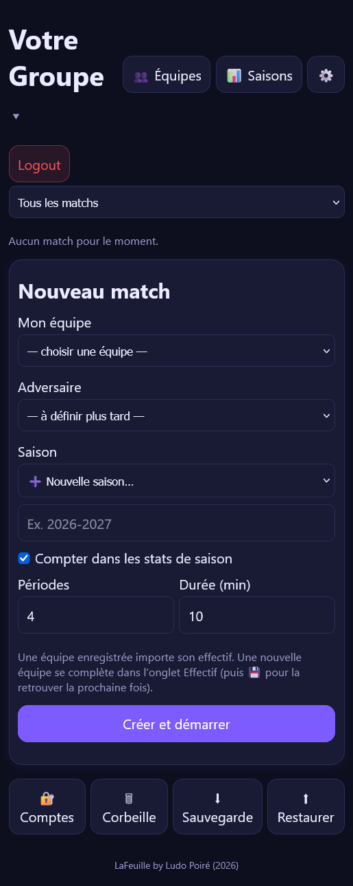
    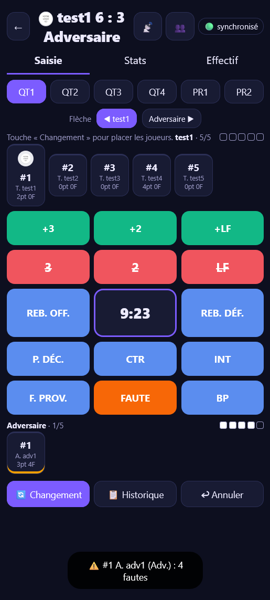
    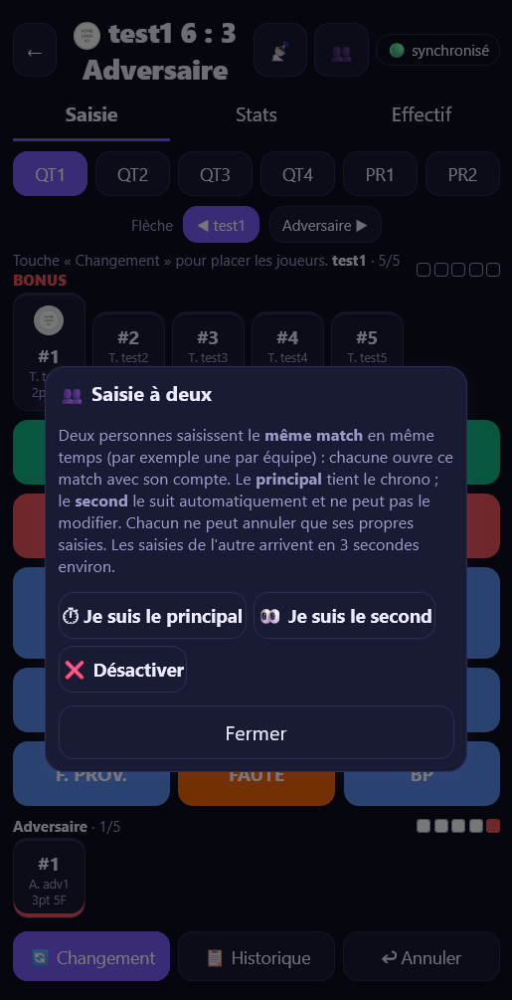
    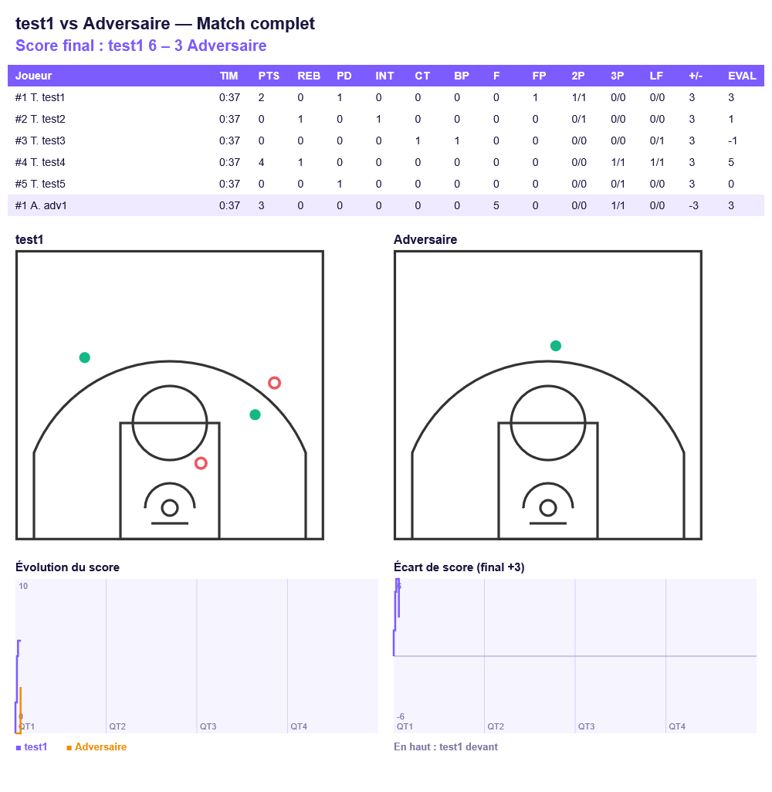

Page d'accueil, écran de saisie (possible à deux) et export de statistiques.

### Pour les spectateurs : le suivi sans compte
- **Un simple code de match** : score, chrono, toutes les stats et historique action par action (play-by-play).
- **Scoreboard plein écran** pour projeter le score dans la salle.
- Pas de compte, pas d'application à télécharger.

    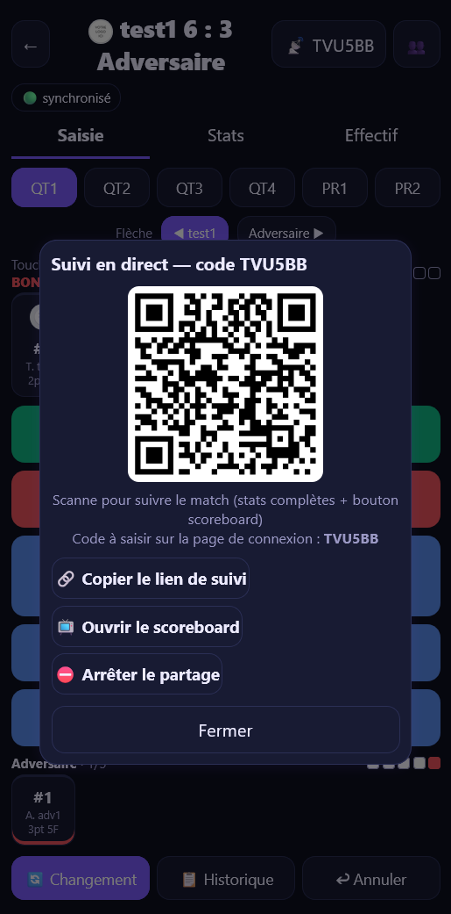
    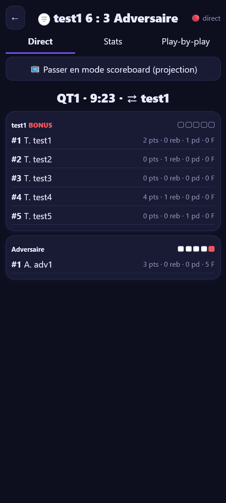
    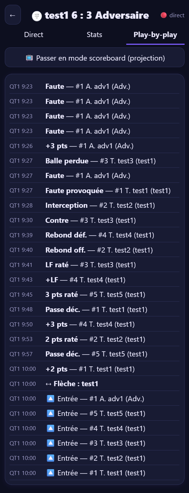

Partage par code ou QR, suivi des stats en direct et play-by-play

### Pour les clubs : saisons et groupes
- **Fiches joueurs et saisons** : moyennes, progression au fil des matchs.
- **Espaces par groupe ou catégorie** (U11, U13, U15, U18…) : chaque coach ne voit et ne modifie que ses groupes.
- **Comptes à rôles** : administrateur, statisticien, lecteur.

    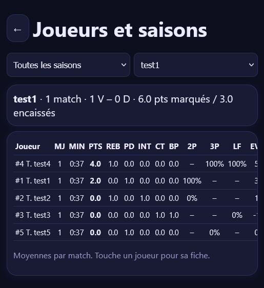
    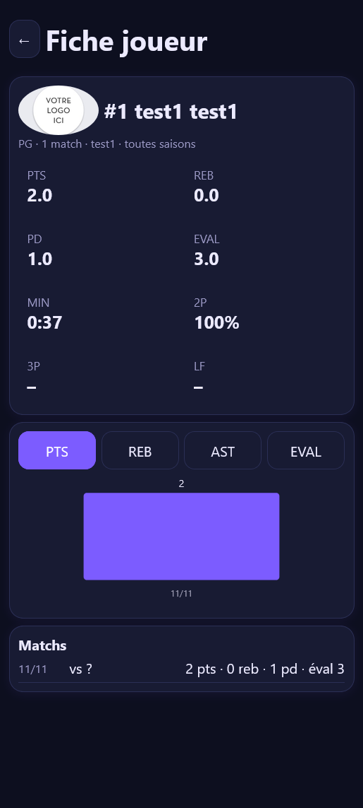
    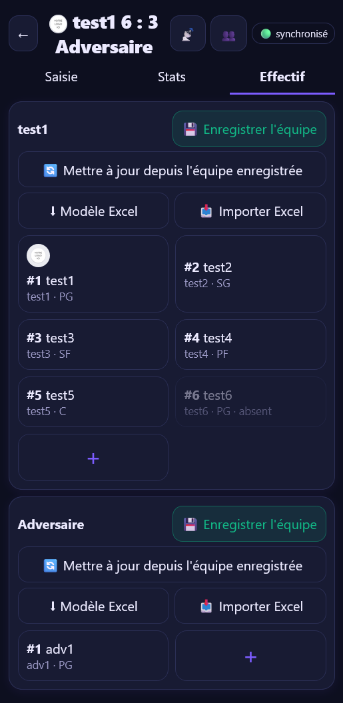

Stats par saison, fiches joueurs et gestion des effectifs. 

### Facile d'utilisation
LaFeuille s'installe comme une vraie application sur l'écran d'accueil (PWA), sur Android comme sur iPhone.

L'outil est aussi utilisable directement sur votre navigateur Internet préféré !

---

## 🚀 Comment l'utiliser

1. **Spectateur ?** Ouvrez le site, cliquez sur *« Suivre un match en direct »* et entrez le code du match donné par le statisticien.
2. **Statisticien ?** Connectez-vous, choisissez votre groupe, créez le match, sélectionnez les présents et les titulaires, puis saisissez action après action. Partagez le code ou le lien du match pour que tout le monde suive en direct.
3. **Coach ou club ?** Demandez la création de votre compte et de vos catégories depuis la page d'accueil. Votre espace est préparé et activé dès validation.

---

## 📱 L'interface

**Curieux ?** Cliquez sur *« Tester par vous-même ! »* pour explorer l'appli en mode démo.

  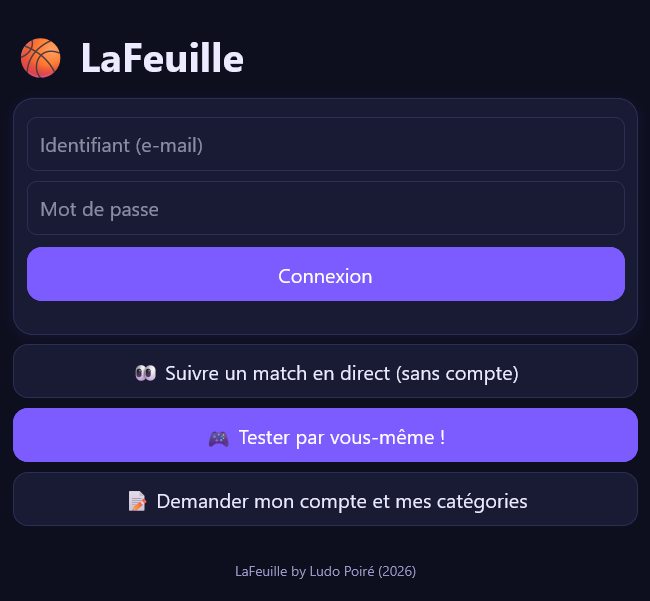

---

## 🛠️ Sous le capot

Pour les curieux qui voudraient ré-utiliser cet outil ou le personnaliser à leur guise, voici son architecture !

| Outil | Rôle |
|---|---|
| Un seul fichier `index.html` | L'application complète (HTML, CSS, JavaScript) |
| [GitHub Pages](https://pages.github.com/) | Hébergement du site |
| [Supabase](https://supabase.com/) | Base de données, comptes et synchronisation en direct |

Aucune étape de compilation : modifier `index.html`, publier, c'est en ligne.

---

## 📬 Contact

Une question, une idée, une demande de compte ? Utilisez le formulaire de la page d'accueil ou ouvrez une [issue](../../issues).

---

<i>Fait avec ❤️ pour ceux qui passent leurs week-ends sur ou à côté des terrains.</i>

<i>Ludo Poiré. 2026</i>

